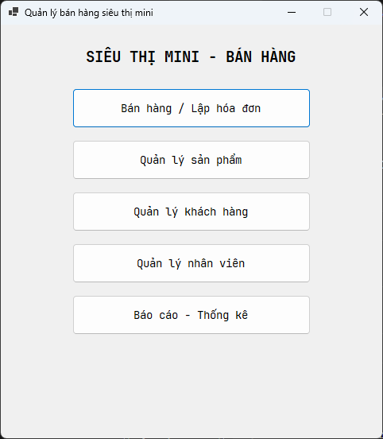
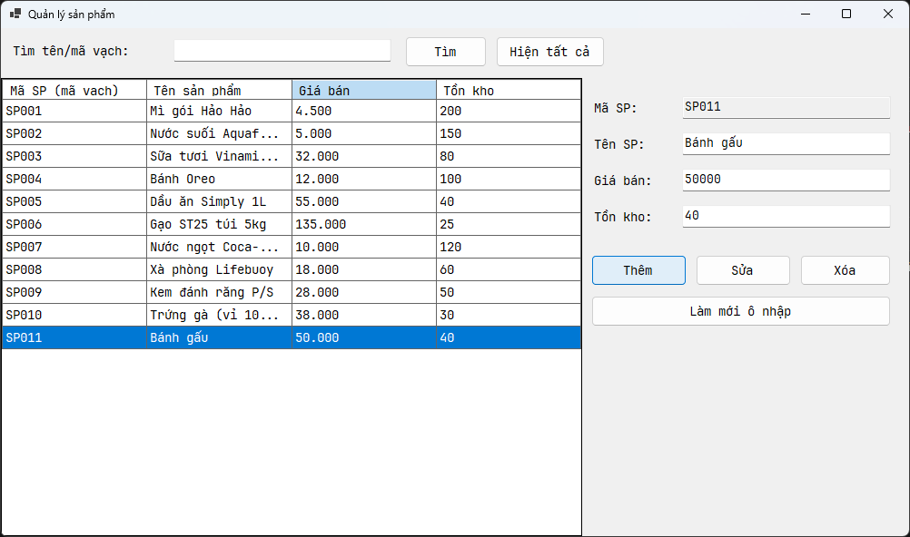
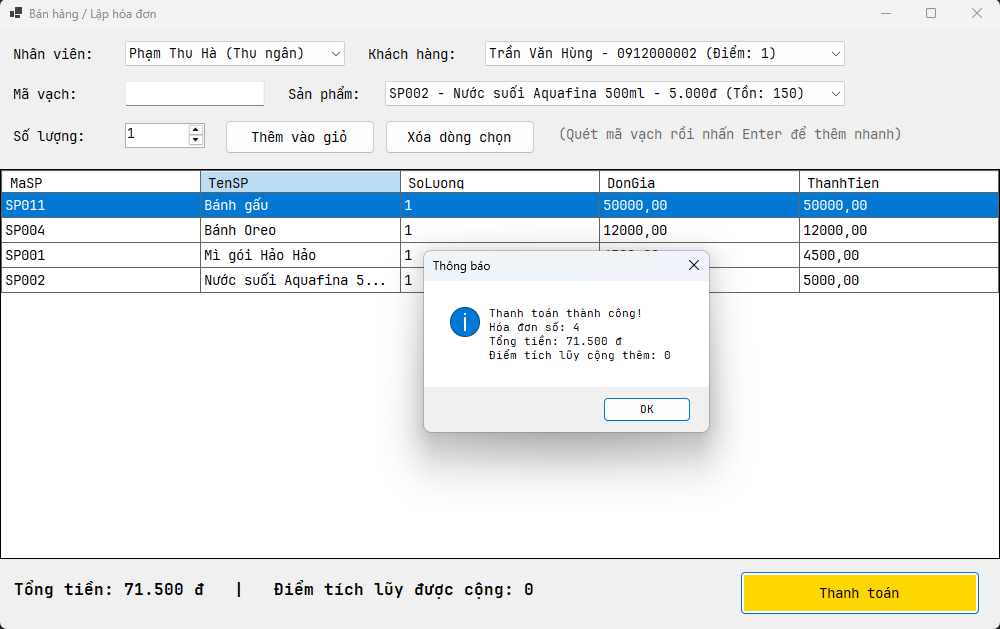
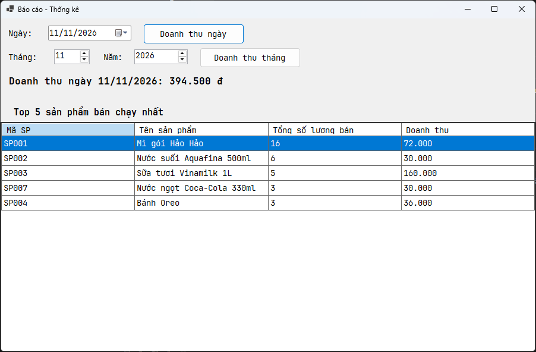
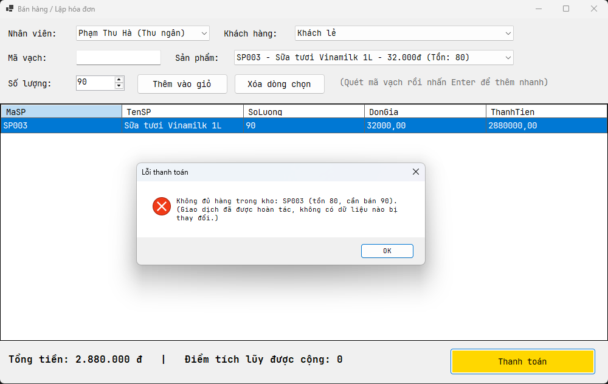
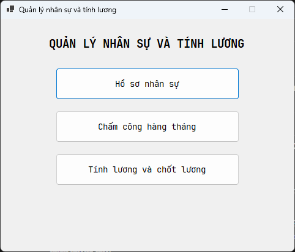
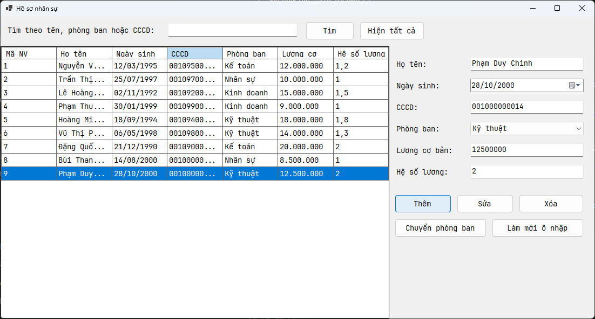
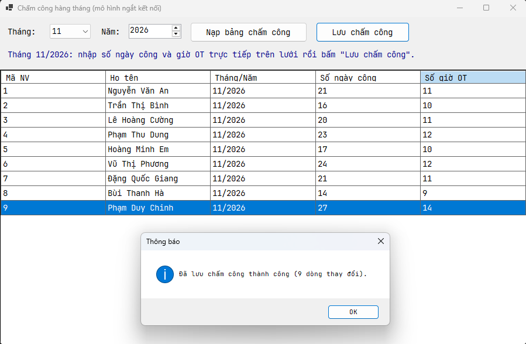
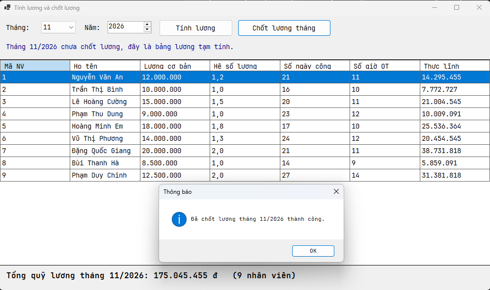
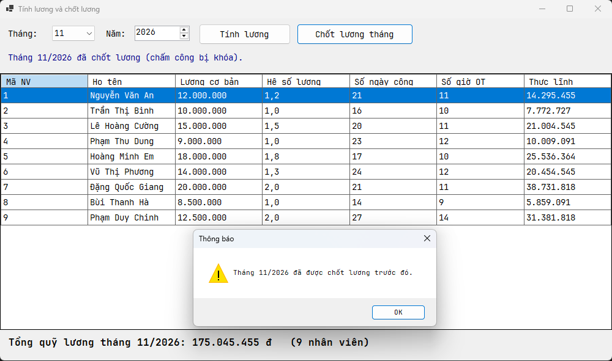

# Bài tập 6.1 - 6.2: Lập trình .NET

### Bài 6.1 - Quản lý bán hàng siêu thị mini

1. **Màn hình chính:**

2. **Màn hình quản lý danh mục:**

3. **Màn hình thực thi chính:**

4. **Màn hình báo cáo - thống kê:**

5. **Màn hình xử lý lỗi:**

---

### Bài 6.2 - Quản lý nhân sự và tính lương

1. **Màn hình chính:**

2. **Màn hình quản lý danh mục:**

3. **Màn hình thực thi chính:**

4. **Màn hình báo cáo - thống kê:**

5. **Màn hình xử lý lỗi:**

