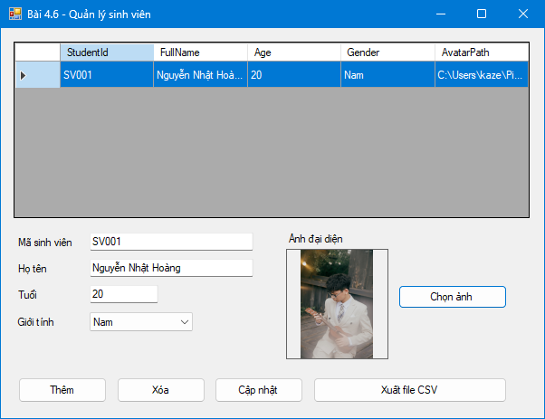
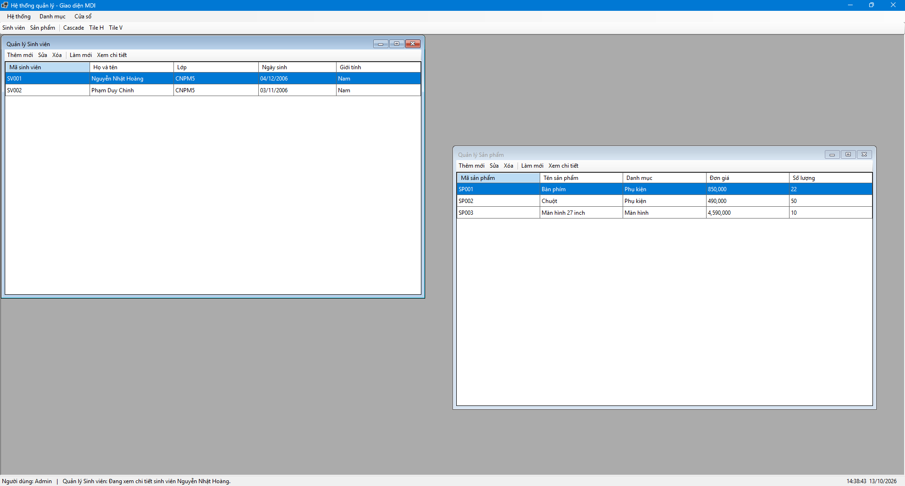
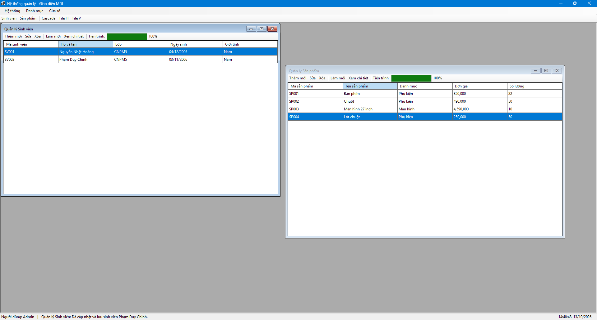

# BÀI TẬP 13/10/2026

## Bài 4.6 - Quản lý dữ liệu với BINDINGSOURCE & xử lý file

---

## Bài 4.7 - Thiết kế khung ứng dụng MDI & quản lý đa cửa sổ

---

## Bài 4.8 - Lập trình bất đồng bộ & tiến trình PROGRESSBAR

