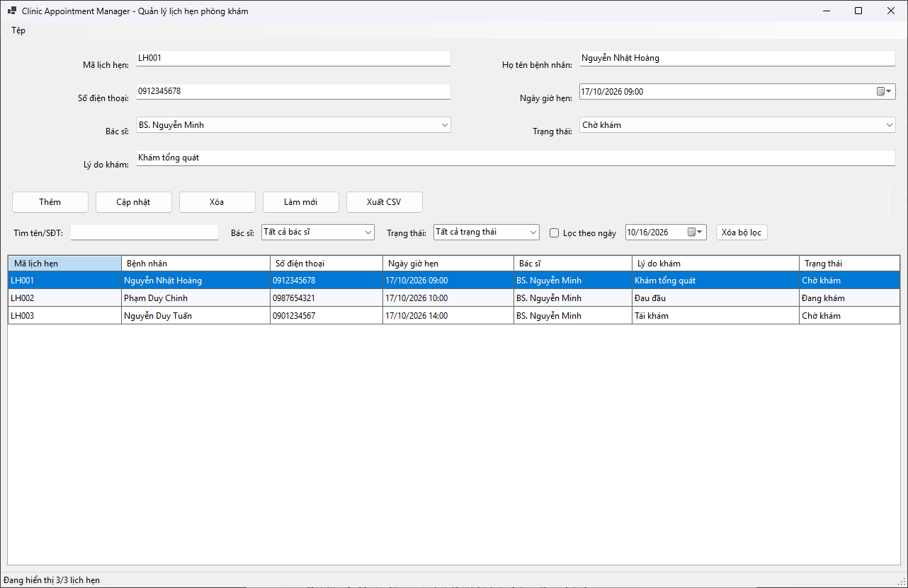
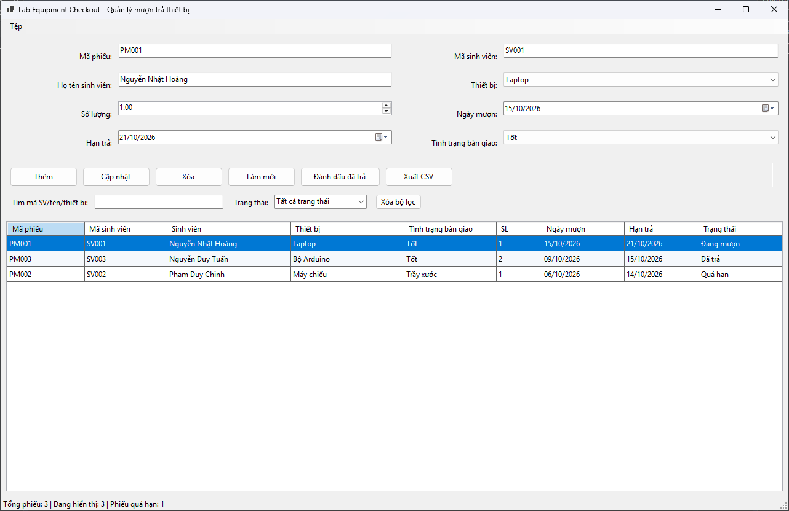
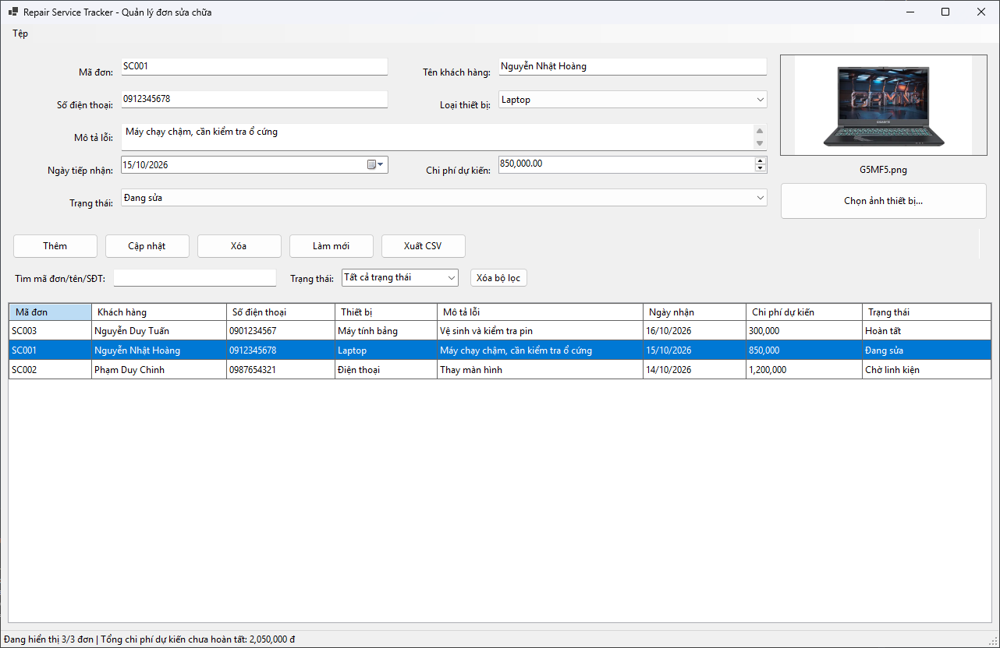

# Bài 4.9: Quản lý lịch hẹn phòng khám - Clinic Appointment Manager

# Bài 4.10: Quản lý mượn trả thiết bị tại phòng thực hành - Lab Equipment Checkout

# Bài 4.11: Quản lý đơn đăng ký dịch vụ sửa chữa - Repair Service Tracker

