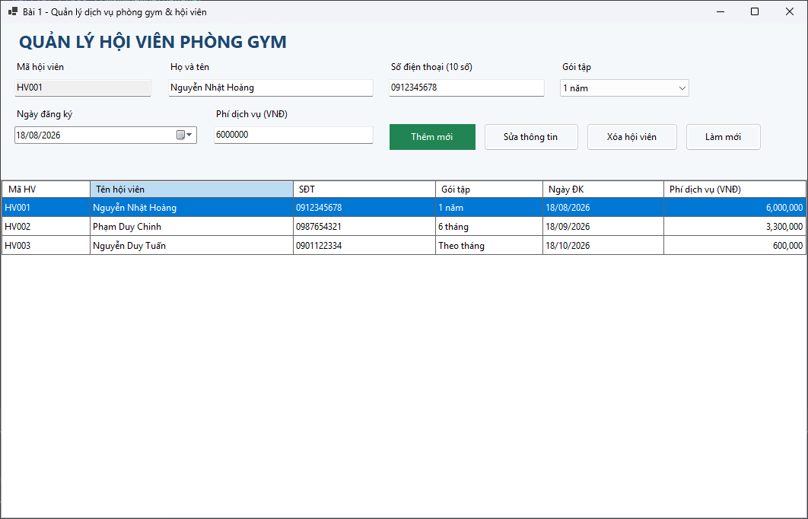
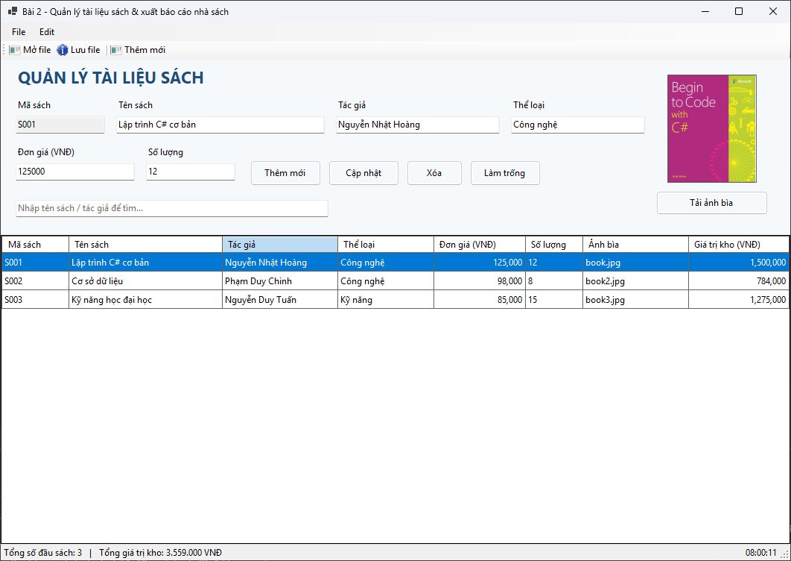
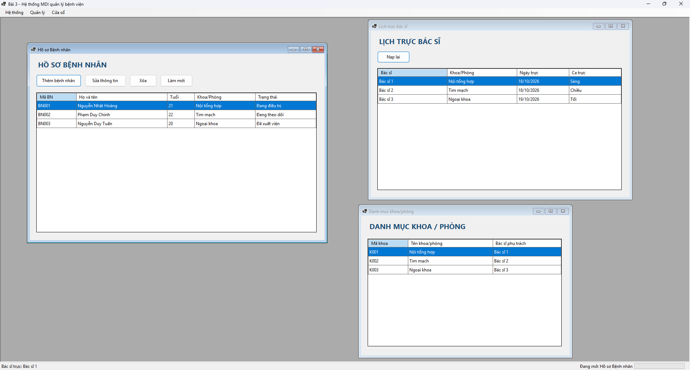
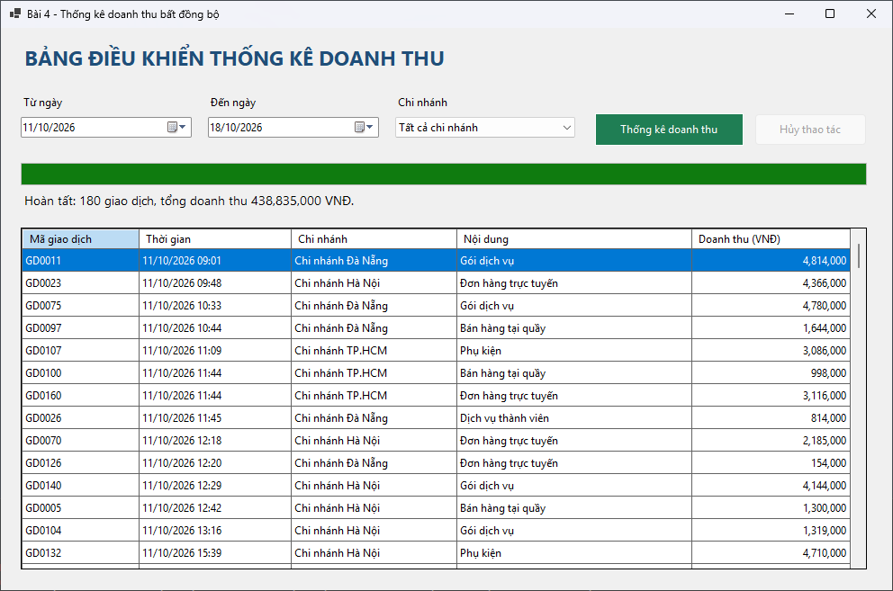
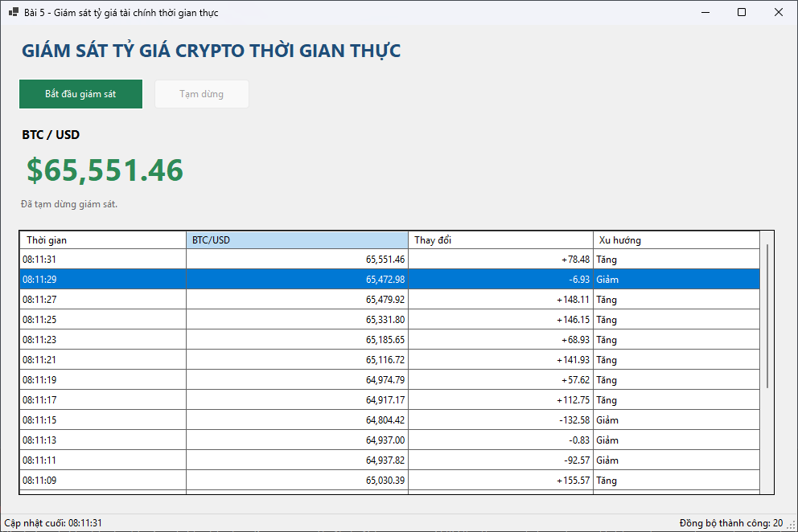

# Bài 1: Hệ thống quản lý dịch vụ phòng Gym & Hội viên

---

# Bài 2: Quản lý tài liệu sách & Xuất báo cáo nhà sách

---

# Bài 3: Hệ thống MDI quản lý bệnh viện & Truy xuất hồ sơ bệnh án

---

# Bài 4: Bảng điều khiển thống kê doanh thu Multi-threading

---

# Bài 5: Mô phỏng giám sát tỷ giá tài chính thời gian thực

