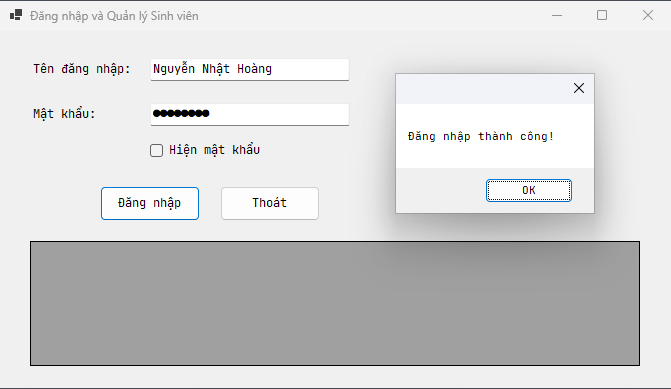
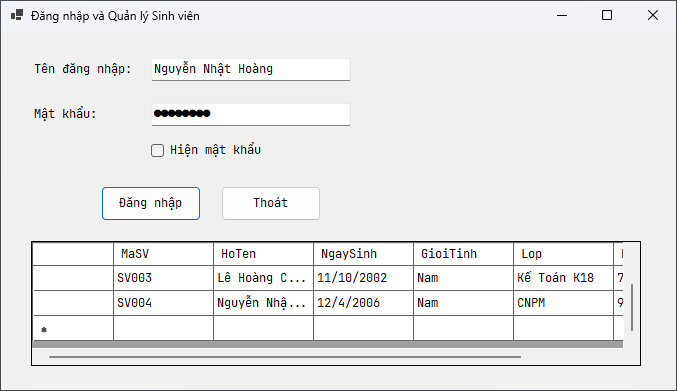
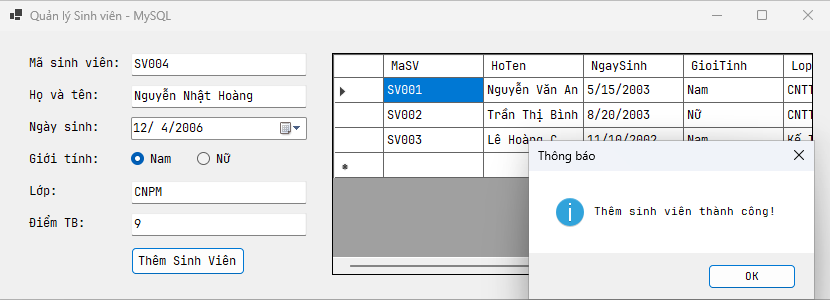
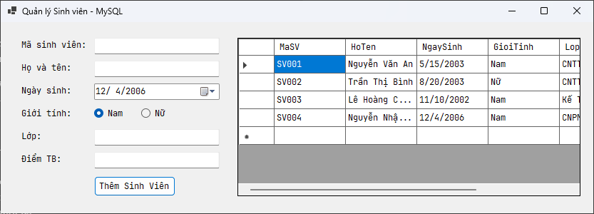
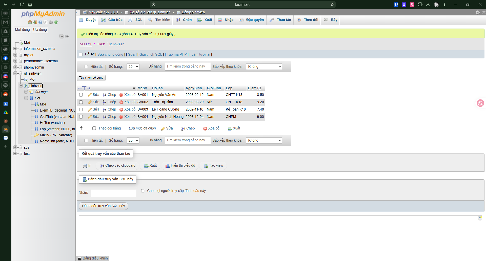

# Bài tập 5.1 - 5.2: Lập trình .NET

Nâng cấp bài tập 4.1 và 4.2 bằng việc lưu trữ vào CSDL MySQL (XAMPP).

## Bài 5.1 - Đăng nhập

Đăng nhập và hiện thông báo thành công:

Danh sách sinh viên trong ứng dụng:

## Bài 5.2 - Quản lý sinh viên (MySQL)

Thêm sinh viên mới và hiện thông báo thành công:

Danh sách sinh viên trong ứng dụng:

Dữ liệu đã được lưu trong CSDL (phpMyAdmin):

