# Bài tập 5.3 - 5.4 - 5.5: Lập trình .NET

### Bài 5.3 - Quản lý quán Cafe

1. Màn hình chính (sơ đồ bàn):

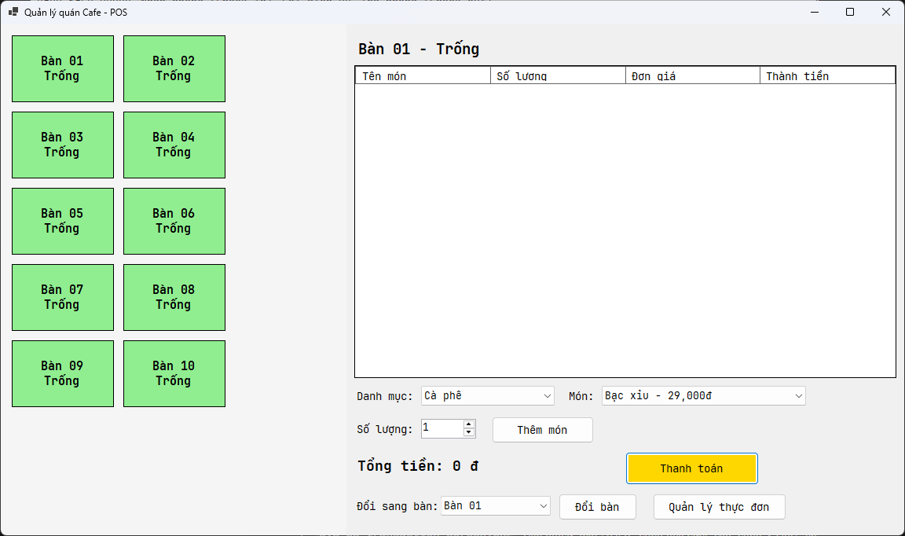

2. Màn hình quản lý thực đơn:

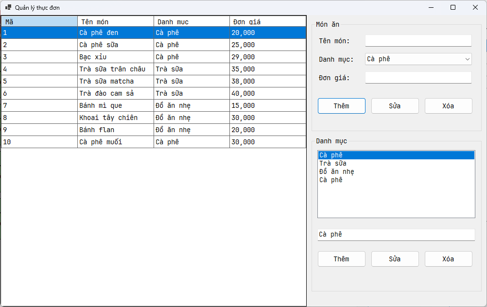

3. Màn hình gọi món - thanh toán:

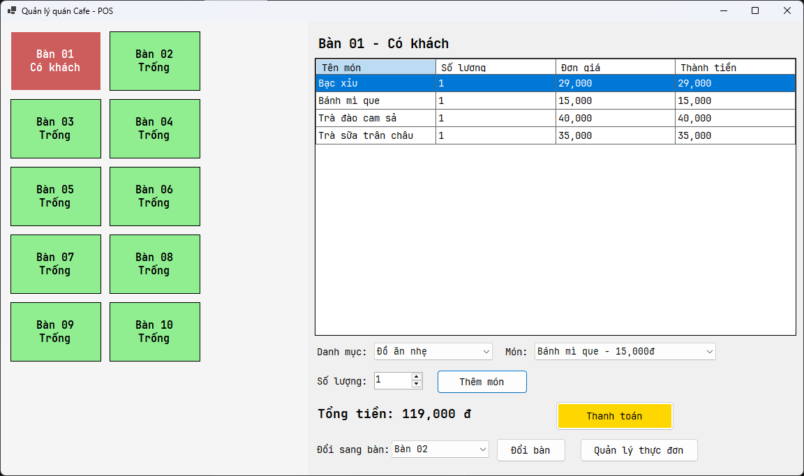

4. Màn hình báo cáo - thống kê:

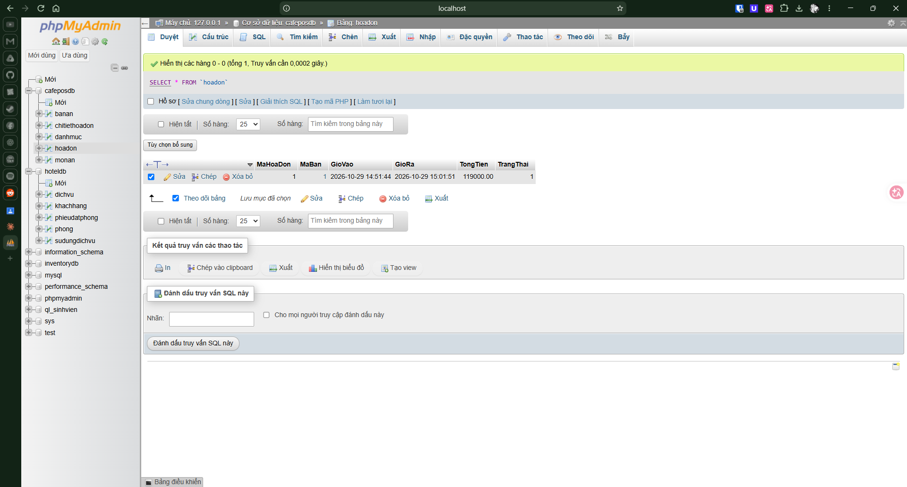

5. Màn hình xử lý lỗi:

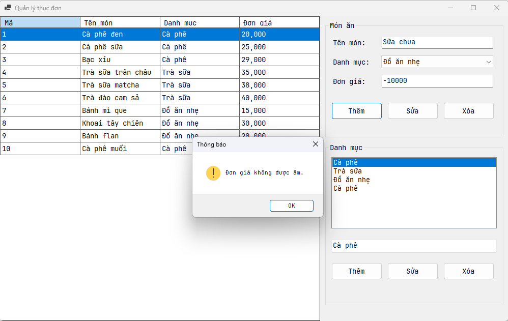

---

### Bài 5.4 - Quản lý khách sạn

1. Màn hình chính (danh sách phòng):

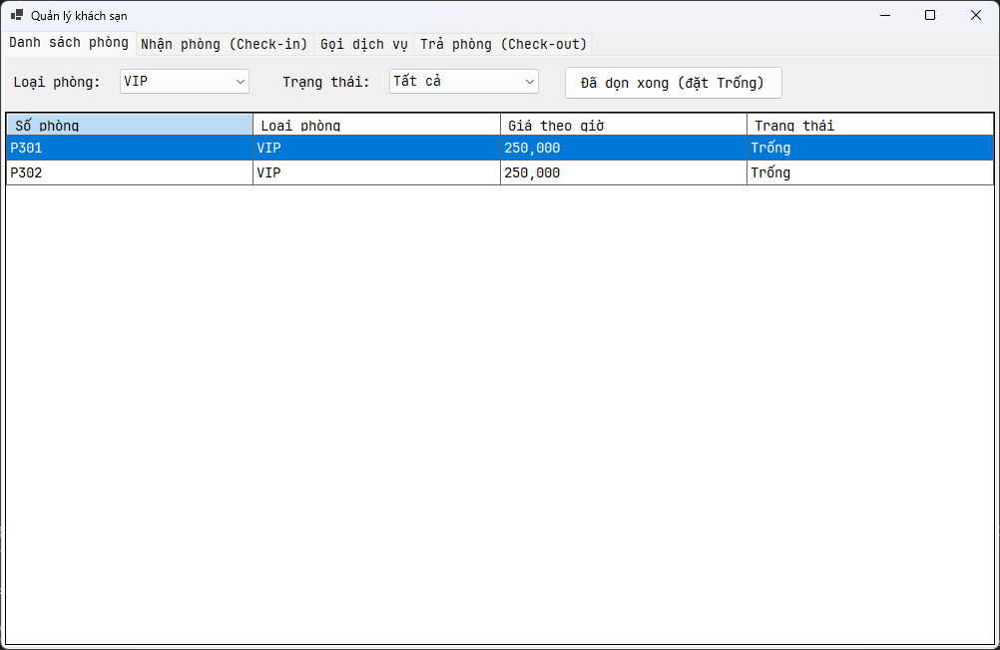

2. Màn hình nhận phòng - trả phòng:

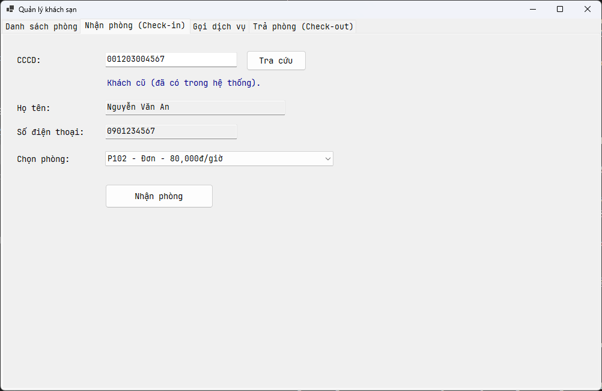

3. Màn hình gọi dịch vụ:

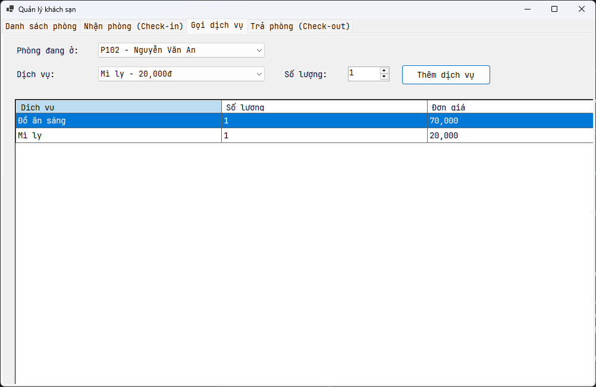

4. Màn hình hóa đơn:

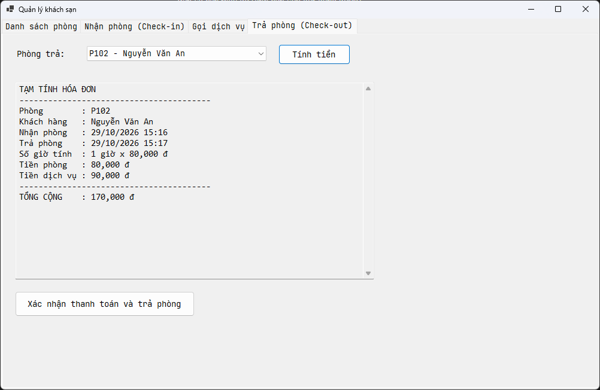

5. Màn hình xử lý lỗi:

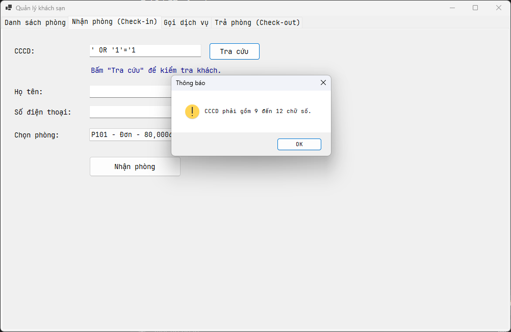

6. Màn hình báo cáo - thống kê:

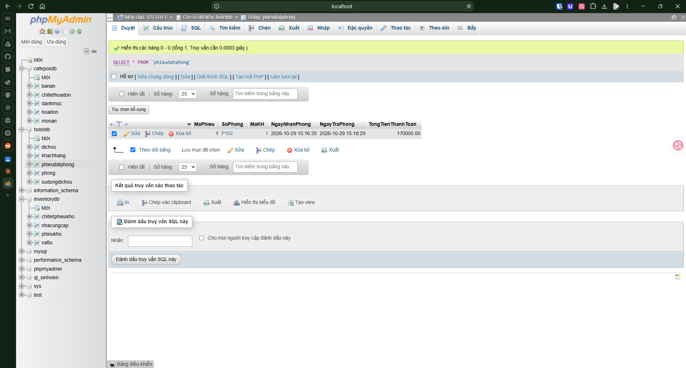

---

### Bài 5.5 - Quản lý kho

1. Màn hình chính:

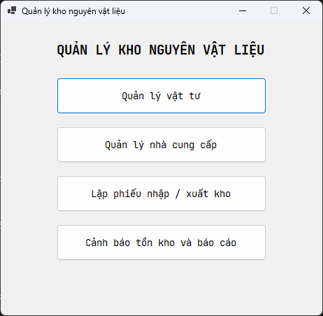

2. Màn hình quản lý vật tư:

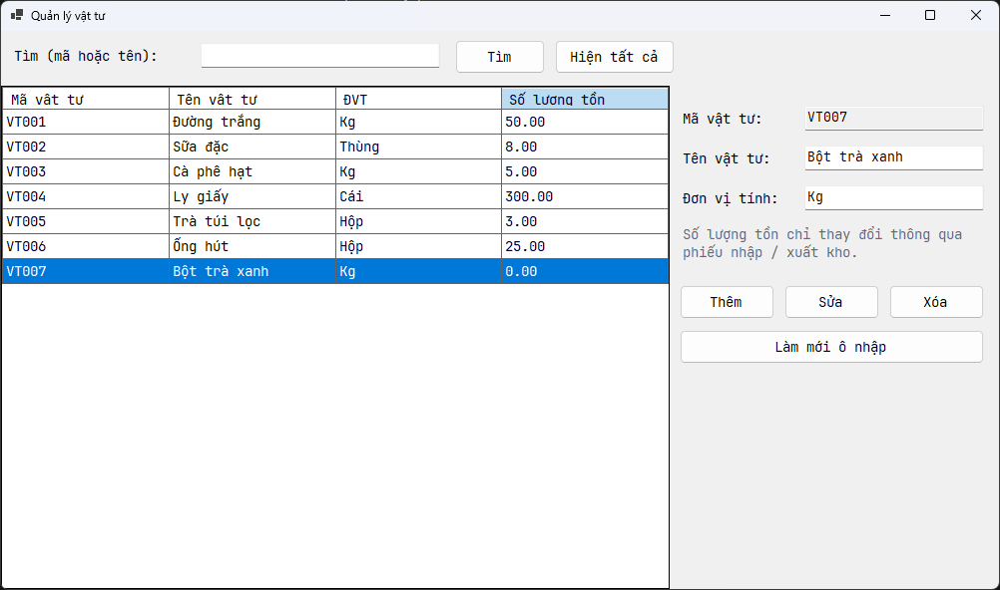

3. Màn hình lập phiếu nhập / xuất kho:

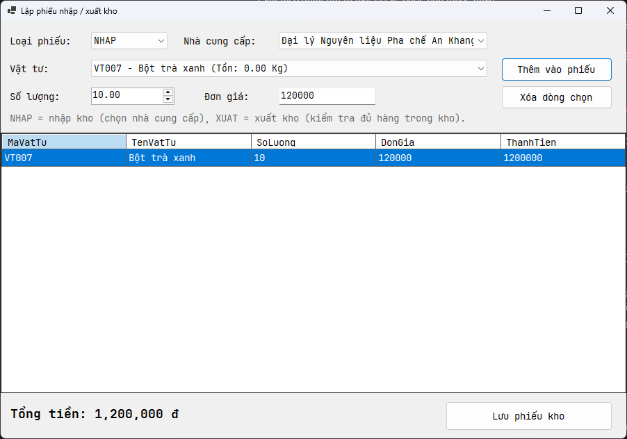

4. Màn hình cảnh báo tồn kho và báo cáo:

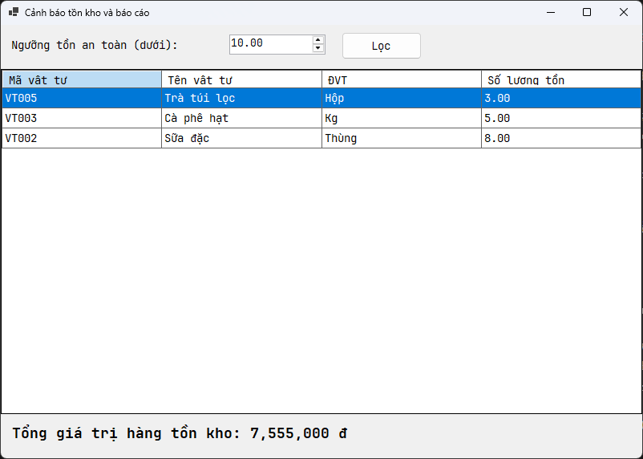

5. Màn hình báo lỗi giao dịch:

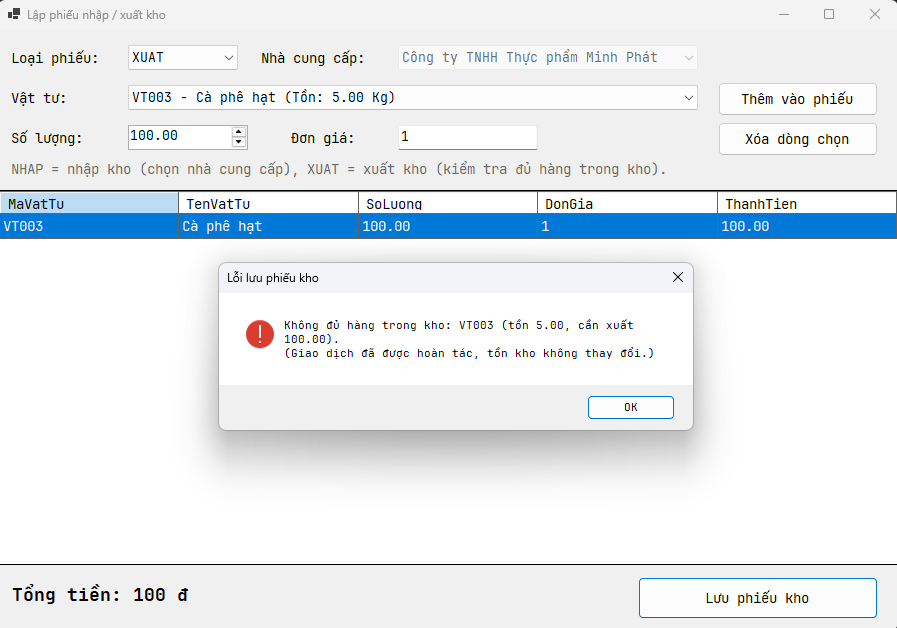

6. Màn hình báo cáo - thống kê:

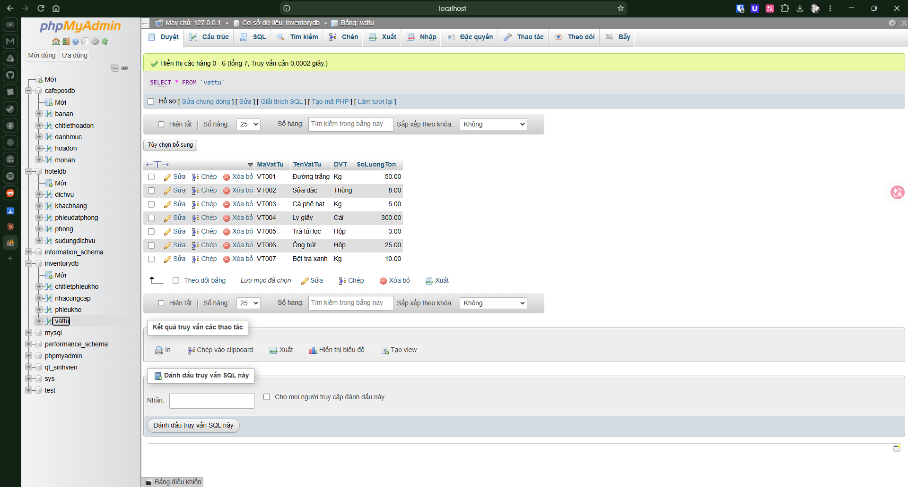